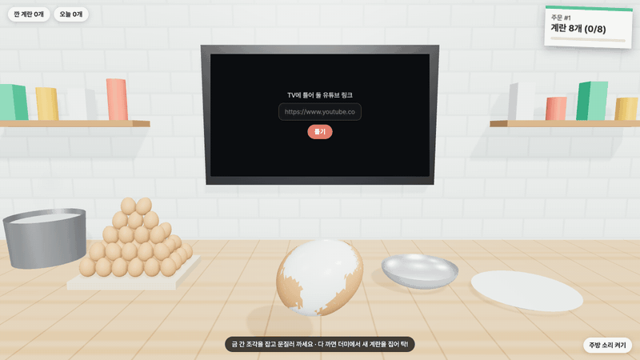
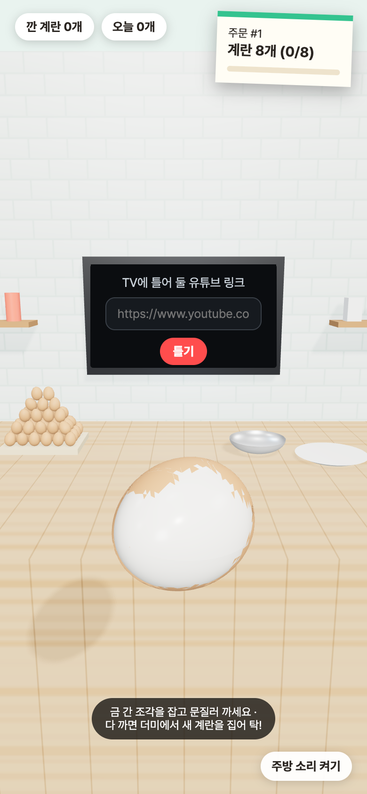

<h1 align="center">계란 까는 주방 · egg-peel</h1>

<p align="center">유튜브 틀어 놓고, 삶은 계란을 탁! 깨서 문질러 까는 3D 주방 놀이<br>
아무 생각 없이 손만 움직이고 싶을 때 틀어 두세요.</p>

<p align="center"><a href="https://egg-peel.pages.dev"><b>▶ 바로 해 보기 · egg-peel.pages.dev</b></a><br>
<sub>PC 크롬·사파리, 폰 브라우저 · 설치 없음 · 로그인 없음</sub></p>

<p align="center"><a href="docs/video/demo.mp4"></a><br>
<sub>▶ <a href="docs/video/demo.mp4">고화질 영상(MP4)</a></sub></p>

---

삶은 계란 까는 그 손맛 있잖아요.
금 간 곳에 손톱을 넣어서 껍질이 쭉 벗겨질 때요.
그걸 유튜브 틀어 놓고 멍하니 계속 할 수 있으면 좋겠다 싶어서 만들었어요.

## 노는 법

1. 왼쪽 계란 더미에서 계란을 집어요.
2. 위로 들었다가 작업대에 빠르게 내리치면 탁! 금이 가요. 세게 칠수록 금이 넓게 가요.
3. 금 간 계란을 누르면 가운데로 와요.
4. 금 간 조각을 잡고 문지르면 껍질이 줄줄이 떨어져요. 다 까면 접시에 쌓여요.

벽에 걸린 TV에 유튜브 링크를 넣으면 그대로 틀어져요. 재생목록도 돼요.

## 들어 있는 것

- **매번 다른 금**: 계란을 쥐는 각도가 매번 달라서 부딪히는 곳도, 금 모양도 매번 달라요. 부딪힌 곳 근처는 잘게, 멀수록 크게 갈라져요.
- **문질러 까기**: 금 간 곳이나 이미 깐 곳 옆부터 떨어져요. 끄는 방향 쪽 조각이 막처럼 같이 딸려 오고, 손을 떼면 다음에 깔 곳이 앞으로 오게 계란이 알아서 돌아요.
- **손맛 연출**: 내리칠 때 순간 멈춤, 화면 흔들림, 튀는 부스러기, 손 옆에 '탁! 파삭' 글자, 폰 진동
- **주방 소리**: 깨지는 소리·껍질 소리·접시 소리, 환풍기와 냄비 보글보글 소리(켜고 끄기)
- **기록과 주문**: 깐 개수와 오늘 기록이 브라우저에 남아요. 가끔 '계란 8개' 같은 주문이 들어와요. 시간 제한은 없어요.
- **폰 세로 화면**: 세로로 들면 카메라가 물러나 주방 전체가 보이고, 까는 계란은 크게 앞으로 와요.

<p align="center"></p>

## 만든 방식

- three.js 0.187(WebGL) · TypeScript · Vite. 서버 없이 브라우저 안에서만 돌아요.
- 껍질은 계란 표면을 부딪힌 곳 기준의 가중 보로노이 조각으로 나누고, 모서리를 나눠 가진 조각끼리 이웃으로 묶어 '뗄 수 있는 조각'을 정해요.
- 소리는 파일 없이 Web Audio로 합성해요.
- 유튜브는 youtube-nocookie 공식 임베드를 쓰고, 링크에서 영상 ID만 뽑아 주소를 만들어요.

기획·설계·결정 과정은 [docs](docs/)에 있어요: [기획서](docs/기획서.md) · [설계서](docs/설계서.md) · [구현도](docs/구현도.md) · [결정기록](docs/결정기록.md)

Claude Code와 같이 만들었어요.

## 개발

```bash
npm install
npm run dev      # http://localhost:5173
npm run build    # 타입 검사 + dist/
npm run deploy   # Cloudflare Pages(egg-peel)
```

## 브랜치

git flow: `main`(릴리스) · `develop`(작업) · `feature/*` · `release/*` · `hotfix/*`, 태그는 `vX.Y.Z`.
