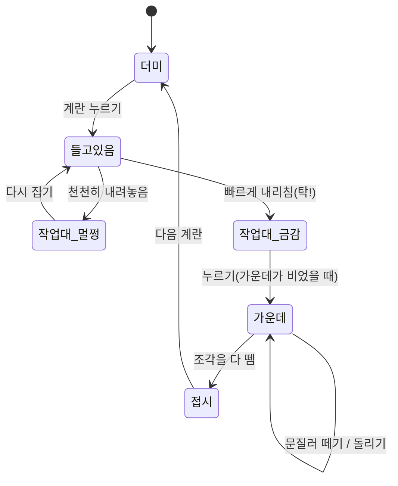
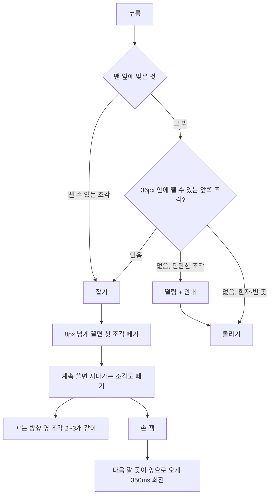

# 계란 까는 주방 구현도

마지막 수정: 2026-11-05 · [기획서](기획서.md) · [설계서](설계서.md) · [결정기록](결정기록.md)

## 폴더

```
egg-peel/
├─ index.html            HUD·TV 자리 마크업
├─ public/_headers       보안 헤더(CSP)
├─ public/favicon.svg
├─ src/
│  ├─ main.ts            시작, 매 프레임 루프
│  ├─ style.css
│  ├─ core/
│  │  ├─ stage.ts        렌더러·장면·카메라, 치수 상수, 색 테마
│  │  └─ materials.ts    재질, 캔버스 텍스처
│  ├─ world/room.ts      주방(벽, 작업대, 선반, 냄비, TV, 그릇, 접시), 빛
│  ├─ egg/
│  │  ├─ shape.ts        계란 모양, 가장 낮은 점
│  │  ├─ crack.ts        금 간 계란 만들기, 조각 상태·이웃, 뗄 수 있는지
│  │  └─ pile.ts         계란 더미
│  ├─ game/
│  │  ├─ state.ts        게임 상태, 기록 저장
│  │  ├─ actions.ts      집기, 내리치기, 가운데로, 떼기, 다 깜, 접시
│  │  └─ input.ts        포인터 입력
│  ├─ fx/effects.ts      날아가는 조각, 부스러기, 찌그러짐, 흔들림·멈춤
│  ├─ audio/sound.ts     합성 소리, 주방 소리
│  └─ ui/
│     ├─ hud.ts          개수·주문표·안내·글자 팝업
│     └─ tv.ts           유튜브 링크 → 임베드, TV 위치 맞추기
└─ docs/
```

## 흐름



## 문질러 떼기



## 구현 순서와 진행

| 순서 | 할 일 | 상태 |
|---|---|---|
| 1 | Vite + TS 뼈대, 장면·카메라·주방 | 완료 |
| 2 | 계란 모양, 더미, 집기·내리치기 | 완료 |
| 3 | 금 간 계란(조각·이웃·상태), 가운데로 | 완료 |
| 4 | 문질러 떼기, 자동 돌리기, 접시 | 완료 |
| 5 | 효과·소리, HUD·주문, 기록 저장 | 완료 |
| 6 | 유튜브 TV(마지막 링크 기억, 바꾸기) | 완료 |
| 7 | CSP, 배포(Cloudflare Pages) | 완료 |
