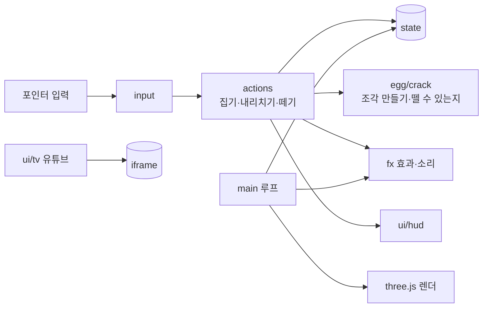

# 계란 까는 주방 설계서

마지막 수정: 2026-11-05 · [기획서](기획서.md) · [구현도](구현도.md) · [결정기록](결정기록.md)

## 플랫폼

웹 하나로 만든다. PC 크롬·사파리, 폰 사파리·크롬에서 같은 주소로 연다.

| 플랫폼 | 지원 | 이유 |
|---|---|---|
| 웹(데스크톱·모바일 브라우저) | 지원 | 유튜브 공식 임베드 플레이어가 웹에서 가장 확실하게 돈다. 설치 없이 링크로 공유할 수 있다 |
| iOS·Android 앱 | 하지 않음 | 앱 웹뷰에서는 유튜브 임베드가 출처(Referer) 문제로 막히는 경우가 있고, 스토어 심사에서 남의 영상 재생이 핵심인 앱은 부담이 된다. 폰은 브라우저로 충분하다 |
| macOS·Windows 앱(Tauri 등) | 하지 않음 | 같은 웹뷰 문제. 혼자 틀어 두는 용도라 브라우저 탭이면 된다 |

화면 비율에 따라 카메라 배치를 바꾼다. 가로는 작업대 정면에서 보고, 세로(폰)는 뒤로 물러나 더미·접시가 다 보이게 한다. 이때 까는 계란은 앞으로 당겨 크게 보인다. 그 사이 비율은 두 배치를 섞는다(`core/stage.ts`).

## 기술 선택

2026-11 웹 검색으로 흐름을 확인했다([2026 웹 3D 라이브러리 비교](https://www.utsubo.com/blog/threejs-vs-babylonjs-vs-playcanvas-comparison), [2026 웹 게임 엔진 비교](https://app.cinevva.com/ko/blog/2026-06-09-web-game-engines-2026-comparison)).

| 항목 | 후보 | 고른 것 | 이유 |
|---|---|---|---|
| 3D | three.js / Babylon.js / PlayCanvas | **three.js 0.187** | 가장 많이 쓰이고(주간 다운로드가 다른 둘보다 훨씬 많음) 코어가 작다. 이 놀이는 물리 엔진·에디터가 필요 없고 조각 나누기·광선 판정을 직접 짜야 해서 렌더링 라이브러리가 맞다. 시안을 이미 three.js로 만들어 검증했다 |
| 렌더러 | WebGLRenderer / WebGPURenderer | **WebGLRenderer** | WebGPU 쪽은 공식 문서에 아직 실험 단계로 적혀 있다. 폰 사파리까지 안정적으로 돌리려면 WebGL2가 낫다 |
| 언어·빌드 | TypeScript + Vite / 순수 JS | **TypeScript + Vite** | 모듈을 나눠도 타입으로 실수를 잡을 수 있다. 하늘 스케치북과 같은 구성이라 배포 흐름을 그대로 쓴다 |
| 물리 | Rapier / cannon-es / 직접 | **직접** | 떨어지는 조각, 바운스 정도라 몇 줄로 된다. 물리 엔진은 번들만 키운다 |
| 소리 | 음원 파일 / Web Audio 합성 | **Web Audio 합성** | 탁·파삭·접시 소리를 노이즈와 필터로 만든다. 파일이 없어 가볍고 저작권 걱정이 없다 |
| 영상 | 유튜브 iframe 임베드(youtube-nocookie) | 그대로 | 공식 플레이어. 쿠키를 덜 남기는 nocookie 도메인을 쓴다 |
| 배포 | Cloudflare Pages / GitHub Pages | **Cloudflare Pages** | 새 주소(`egg-peel.pages.dev`), `_headers`로 보안 헤더(CSP)를 걸 수 있다 |

## 아키텍처

서버가 없다. 모든 상태는 브라우저 안에 있고 기록만 `localStorage`에 남긴다.

## 계란 껍질 모델

- 계란 모양은 회전체(LatheGeometry). 반지름 2.4cm, 반높이 3.1cm, 한쪽이 살짝 뾰족하다.
- 내리칠 때 계란의 가장 아래 점을 **부딪힌 곳**으로 잡는다. 집을 때마다 쥐는 각도를 무작위로 바꿔서 매번 다른 곳이 부딪힌다.
- 껍질을 삼각형 단위로 **가중 보로노이 조각**으로 나눈다. 씨앗은 부딪힌 곳 근처에 촘촘하고 멀수록 듬성하다. 그래서 가까운 조각은 잘고 먼 조각은 크다.
- 조각 상태는 세 단계다. 부딪힌 곳에서 `0.007 + 세기×0.017`m 안은 **벌어짐**(틈이 보임), 그 1.6배 안은 **실금**, 나머지는 **멀쩡**하다.
- 조각끼리 같은 모서리를 나눠 가지면 **이웃**이다.
- 뗄 수 있는 조각은 벌어진 조각, 또는 이웃 중에 이미 떨어진 것이 있는 조각이다.
- 클릭 판정은 흰자와 조각을 같이 광선으로 검사해서 맨 앞에 맞은 것만 본다. 뒤쪽 조각은 흰자에 가려 잡히지 않는다.

## 저장 데이터 (localStorage)

| 키 | 값 |
|---|---|
| `egg-peel:total` | 지금까지 깐 개수 |
| `egg-peel:day:YYYY-MM-DD` | 그날 깐 개수 |
| `egg-peel:yt` | 마지막으로 튼 유튜브 링크 |
| `egg-peel:amb` | 주방 소리 켜짐 여부 |

## 보안

- 사용자가 넣는 값은 유튜브 링크 하나다. 정규식으로 영상 ID(11자)와 재생목록 ID만 뽑아 `youtube-nocookie.com/embed/` 주소를 직접 만든다. 입력 문자열을 그대로 HTML이나 주소에 넣지 않는다.
- `_headers`에 CSP를 건다.
  - 스크립트는 자기 출처만 허용한다.
  - iframe은 youtube-nocookie만 허용한다.
  - 글꼴·스타일은 Pretendard CDN만 허용한다.

## 성능

- 매 프레임 할당을 줄인다(벡터 재사용).
- 떨어진 조각은 1.6초 뒤 장면에서 빼고 재질을 해제한다.
- 깐 계란이 접시에 쌓이면 주문이 끝날 때 접시를 비운다.
- 픽셀 비율은 2까지, 그림자 맵은 2048(폰은 1024).
- 번들은 three.js 포함 약 577kB(gzip 147kB). 한 화면짜리라 나누지 않는다.
- 부스러기 도형은 세 가지를 만들어 같이 쓰고, 소리용 노이즈 버퍼는 길이별로 한 번만 만든다.
