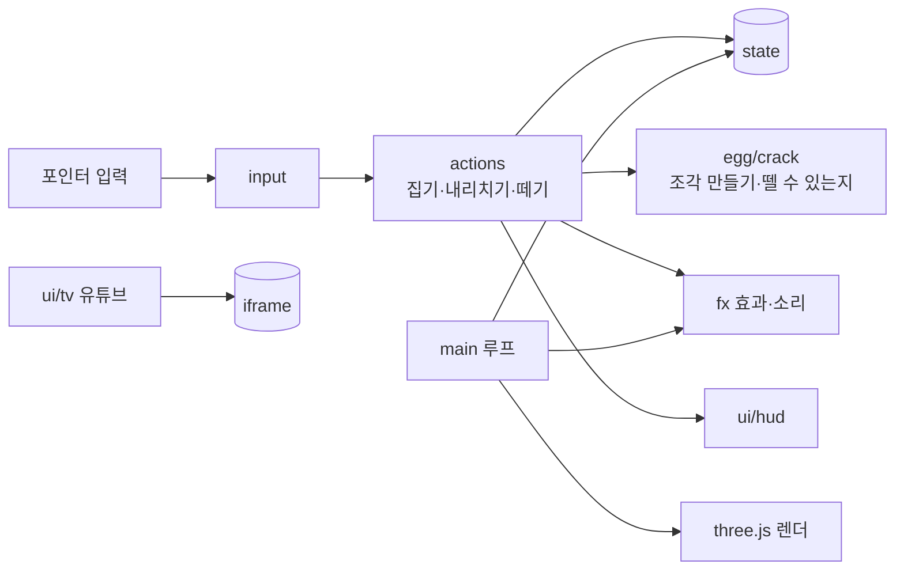

# 계란 까는 주방 설계서

마지막 수정: 2026-11-10 · [기획서](기획서.md) · [구현도](구현도.md) · [결정기록](결정기록.md)

## 플랫폼

웹 하나로 만든다. PC 크롬·사파리, 폰 사파리·크롬에서 같은 주소로 연다.

| 플랫폼 | 지원 | 이유 |
|---|---|---|
| 웹(데스크톱·모바일 브라우저) | 지원 | 유튜브 공식 임베드 플레이어가 웹에서 가장 확실하게 돈다. 설치 없이 링크로 공유할 수 있다 |
| iOS·Android 앱 | 하지 않음 | 앱 웹뷰에서는 유튜브 임베드가 출처(Referer) 문제로 막히는 경우가 있고, 스토어 심사에서 남의 영상 재생이 핵심인 앱은 부담이 된다. 폰은 브라우저로 충분하다 |
| macOS·Windows 앱(Tauri 등) | 하지 않음 | 같은 웹뷰 문제. 혼자 틀어 두는 용도라 브라우저 탭이면 된다 |

화면 비율에 따라 카메라 배치를 바꾼다. 가로는 작업대 정면에서 보고, 세로(폰)는 뒤로 물러나 더미·접시가 다 보이게 한다. 이때 까는 계란은 앞으로 당겨 크게 보인다. 그 사이 비율은 두 배치를 섞는다(`core/stage.ts`).

2026-11-08부터 **모바일 웹이 먼저**다. 폰 세로 화면에 맞춰 만들고, PC·가로 화면은 벽걸이 TV 배치를 그대로 둔다.

| 화면 | TV | 3D 주방 |
|---|---|---|
| 폰 세로 (가로/세로 < 0.8) | 화면 위쪽 띠. 폭 가득 16:9, 화면 높이의 32%까지(+노치 여백) | 띠 아래만 그린다. 벽 TV 모형은 숨기고 시선을 작업대로 내린다(`BAND` 배치) |
| 그 밖(가로 폰·태블릿·PC) | 벽걸이 TV 화면 네 귀퉁이에 맞춰 얹는다 | 화면 전체 |

- 3D 화면이 차지하는 영역은 `VIEW = { top, w, h }`(`core/stage.ts`). 클릭 광선(`game/input.ts`), 월드→화면 좌표(`toScreen`), TV 위치(`ui/tv.ts`)가 모두 이 값을 쓴다. 위쪽 띠가 있을 때도 손가락 위치와 3D 물체가 어긋나지 않게 하려는 것이다.
- 손가락 크기: 아래 버튼과 TV `틀기` 버튼은 44px 이상, 유튜브 링크 칸 글자는 16px(iOS 입력 확대 방지).
- 가로 폰(높이 500px 이하): 주문 쪽지·숫자 칩을 작게, 안내 문구는 왼쪽 아래로 옮겨 오른쪽 아래 버튼과 안 겹치게 한다.
- 화면 확대 막기(`maximum-scale=1`)는 뺐다. 게임 화면은 `touch-action: none` 이라 원래 핀치가 안 먹고, 막아 두면 글자를 키워 보려는 사람만 불편하다.
- 세로 폰 손맛(2026-11-09): 가운데가 비어 있으면 내리친 계란이 0.5초 뒤 저절로 가운데로 온다. 작업대 계란·더미는 손가락 근처(터치 44px, 마우스 24px)면 잡힌다. 작업대 소품(더미·쟁반·접시·냄비)을 가운데로 모으고(`BAND_SPREAD` 0.62, `spreadRoom`/`movePile`) 카메라를 당겼다. 은색 볼(껍질 그릇)은 2026-11-10부터 이 배치에서 쟁반과 접시 사이 뒤쪽으로 옮겨 둔다.
- 렌더 아끼기: 탭이 숨으면 렌더 루프를 멈추고, 터치 기기 픽셀 배율 상한은 1.5. 가만히 있을 때 초당 12번만 그리던 것(1.2.0)은 폰에서 끊겨 보여 1.2.1에서 뺐다.
- TV 링크: 틀린 링크는 지우지 않고 아래에 오류 문장(role=alert). '링크 바꾸기'는 보던 영상 위에 폼을 덮고 '취소'(Esc)로 돌아간다.
- 끝맺음: 접시를 민트색으로(흰 계란이 보이게), 주문을 다 채우면 쪽지에 '완료' 도장 → 쪽지가 날아가고 새 쪽지 → 접시 비우기. 토스트는 진한 바탕.
- 접근성: 안내·토스트에 aria-live, 소리 버튼 aria-pressed, 진한 포커스 링, '틀기' 버튼 #d63031(4.9:1). 동작 줄이기 설정이면 화면 흔들림을 끈다.
- 홈 화면에 추가(PWA): `public/manifest.webmanifest` + 아이콘(192·512·maskable, apple-touch 180). 화면은 `standalone`. 오프라인 캐시는 넣지 않는다. 유튜브가 온라인이어야 하는 놀이라서.

## 기술 선택

2026-11 웹 검색으로 흐름을 확인했다([2026 웹 3D 라이브러리 비교](https://www.utsubo.com/blog/threejs-vs-babylonjs-vs-playcanvas-comparison), [2026 웹 게임 엔진 비교](https://app.cinevva.com/ko/blog/2026-06-09-web-game-engines-2026-comparison)).

| 항목 | 후보 | 고른 것 | 이유 |
|---|---|---|---|
| 3D | three.js / Babylon.js / PlayCanvas | **three.js 0.187** | 가장 많이 쓰이고(주간 다운로드가 다른 둘보다 훨씬 많음) 코어가 작다. 이 놀이는 물리 엔진·에디터가 필요 없고 조각 나누기·광선 판정을 직접 짜야 해서 렌더링 라이브러리가 맞다. 시안을 이미 three.js로 만들어 검증했다 |
| 렌더러 | WebGLRenderer / WebGPURenderer | **WebGLRenderer** | WebGPU 쪽은 공식 문서에 아직 실험 단계로 적혀 있다. 폰 사파리까지 안정적으로 돌리려면 WebGL2가 낫다 |
| 언어·빌드 | TypeScript + Vite / 순수 JS | **TypeScript + Vite** | 모듈을 나눠도 타입으로 실수를 잡을 수 있다. 하늘 스케치북과 같은 구성이라 배포 흐름을 그대로 쓴다 |
| 물리 | Rapier / cannon-es / 직접 | **직접** | 떨어지는 조각, 바운스 정도라 몇 줄로 된다. 물리 엔진은 번들만 키운다 |
| 소리 | 음원 파일 / Web Audio 합성 | **Web Audio 합성** | 탁·파삭·접시 소리를 노이즈와 필터로 만든다. 파일이 없어 가볍고 저작권 걱정이 없다 |
| 영상 | 유튜브 iframe 임베드(youtube-nocookie) | 그대로 | 공식 플레이어. 쿠키를 덜 남기는 nocookie 도메인을 쓴다 |
| 배포 | Cloudflare Pages / GitHub Pages | **Cloudflare Pages** | 새 주소(`egg-peel.pages.dev`), `_headers`로 보안 헤더(CSP)를 걸 수 있다 |

## 아키텍처

서버가 없다. 모든 상태는 브라우저 안에 있고 기록만 `localStorage`에 남긴다.

## 계란 껍질 모델

- 계란 모양은 한쪽이 살짝 뾰족한 회전체 윤곽이다. 반지름 2.4cm, 반높이 3.1cm. 도형은 정이십면체를 잘게 나눈 구를 그 윤곽에 맞춰 늘려 만든다(`egg/shape.ts`). 삼각형 크기가 고르고(넓이 최대/최소 2.5배), 법선은 윤곽 식을 미분해 넣어 이음매가 없다. 껍질 8,820개, 흰자 3,380개, 더미 1,280개 삼각형.
- 내리칠 때 계란의 가장 아래 점을 **부딪힌 곳**으로 잡는다. 집을 때마다 쥐는 각도를 무작위로 바꿔서 매번 다른 곳이 부딪힌다.
- 껍질을 삼각형 단위로 **가중 보로노이 조각**으로 나눈다(`egg/fracture.ts`, 렌더러 없이 테스트한다). 씨앗은 부딪힌 곳 근처에 촘촘하고 멀수록 듬성하다. 그래서 가까운 조각은 잘고 먼 조각은 크다.
- 조각 상태는 세 단계다. 부딪힌 곳에서 `0.007 + 세기×0.017`m 안은 **벌어짐**(틈이 보임), 그 1.6배 안은 **실금**, 나머지는 **멀쩡**하다.
- 조각끼리 같은 모서리를 나눠 가지면 **이웃**이다.
- 뗄 수 있는 조각은 벌어진 조각, 또는 이웃 중에 이미 떨어진 것이 있는 조각이다.
- 클릭 판정은 흰자와 조각을 같이 광선으로 검사해서 맨 앞에 맞은 것만 본다. 뒤쪽 조각은 흰자에 가려 잡히지 않는다.

## 저장 데이터 (localStorage)

| 키 | 값 |
|---|---|
| `egg-peel:total` | 지금까지 깐 개수 |
| `egg-peel:day:YYYY-MM-DD` | 그날 깐 개수 |
| `egg-peel:yt` | 마지막으로 튼 유튜브 링크 |
| `egg-peel:amb` | 주방 소리 켜짐 여부 |
| `egg-peel:quiet` | 조용히(글자·토스트·흔들림 끄기) 켜짐 여부 |

## 보안

- 사용자가 넣는 값은 유튜브 링크 하나다. 정규식으로 영상 ID(11자)와 재생목록 ID만 뽑아 `youtube-nocookie.com/embed/` 주소를 직접 만든다. 입력 문자열을 그대로 HTML이나 주소에 넣지 않는다.
- `_headers`에 CSP를 건다.
  - 스크립트는 자기 출처만 허용한다.
  - iframe은 youtube-nocookie만 허용한다.
  - 글꼴·스타일은 Pretendard CDN만 허용한다.

## 성능

- 매 프레임 할당을 줄인다(벡터 재사용).
- 떨어진 조각은 재질을 복제하지 않는다. 0.6초 동안 껍질 그릇으로 날아가 그릇 안 조각(InstancedMesh)으로 바뀐다. 부스러기는 크기를 줄여 사라진다. 투명 재질을 쓰면 뗄 때마다 셰이더 프로그램이 새로 컴파일됐다(2026-11-10).
- 그림자 맵은 움직이는 것이 있는 프레임에만 다시 그린다(`shadowDirty`, `main.ts tick`). 숨 쉬는 움직임은 뺀다. 처음 세 프레임은 그림자 깊이 셰이더를 미리 컴파일하려고 계속 그린다.
- 더미 52개는 InstancedMesh 하나다. 가만히 있을 때 그리기 호출은 PC 40 안팎, 세로 폰 30 안팎이다(전 166 / 157).
- WebGL 컨텍스트가 복구되면 환경맵과 그림자 맵을 다시 만든다.
- 광량: 노출 1.0, 환경광 0.3, 반구광 0.45, 직사광 2.0, Neutral 톤매핑. 접시 `#9fd8bf` 가 화면에서 `#9ed5bb` 로 나오게 맞춘 값이다.
- 깐 계란이 접시에 쌓이면 주문이 끝날 때 접시를 비운다.
- 들고 있는 계란은 벽 TV(HTML)에 가려지지 않는 높이까지만 올라간다(`core/geom.ts heldCeiling`).
- 픽셀 비율은 2까지, 그림자 맵은 2048(폰은 1024).
- 번들은 three.js 포함 약 588kB(gzip 151kB). 한 화면짜리라 나누지 않는다.
- 부스러기 도형은 세 가지를 만들어 같이 쓰고, 소리용 노이즈 버퍼는 길이별로 한 번만 만든다.
